  

  

  

    
    
    
  

<h1>🪐 About Me</h1>

<table align="center">
  <tr>
    <td width="35%" align="center">
      
    </td>
    <td width="65%" valign="top">
      

        I am <b>Abdul Wahab</b>, a Software Engineering student at <b>FAST NUCES</b>. I am a dedicated Full Stack Developer with a deep interest in backend systems and data science. My goal is to build scalable, high-performance applications that solve real-world problems.
      

      <h3 align="left">🔭 Focus Areas</h3>
      <ul align="left">
        <li>🚀 <b>Full-Stack Development</b> (Modern Web Architectures)</li>
        <li>⚙️ <b>Backend Systems</b> (Scalable APIs & Microservices)</li>
        <li>🤖 <b>Data Science</b> (Computer Vision & Machine Learning)</li>
        <li>🧠 <b>Teaching & Mentoring</b> (Previous Teaching Assistant)</li>
      </ul>
    </td>
  </tr>
</table>

<h1>🛡️ Technical Arsenal</h1>

  

    

  
   
  
   
  

 

<table align="center">
  <tr>
    <td align="center" width="50%" valign="top">
      <h3>💻 Languages</h3>
      <i>from the metal to the browser</i>
        
      
      
      
      
      
      
    </td>
    <td align="center" width="50%" valign="top">
      <h3>🎨 Frontend & Web</h3>
      <i>pixels with a purpose</i>
        
      
      
      
      
    </td>
  </tr>
  <tr>
    <td align="center" width="50%" valign="top">
      <h3>⚙️ Backend & APIs</h3>
      <i>APIs that don't flinch under load</i>
        
      
      
      
    </td>
    <td align="center" width="50%" valign="top">
      <h3>🤖 Computer Vision & Data Science</h3>
      <i>teaching machines to see & think</i>
        
      
      
      
      
      
    </td>
  </tr>
  <tr>
    <td align="center" width="50%" valign="top">
      <h3>🗄️ Databases</h3>
      <i>where the data lives</i>
        
      
      
      
    </td>
    <td align="center" width="50%" valign="top">
      <h3>🛠️ DevOps & Infrastructure</h3>
      <i>containerize it, scale it, ship it</i>
        
      
      
      
      
    </td>
  </tr>
  <tr>
    <td align="center" colspan="2">
      <h3>🧪 Tools & Testing</h3>
      <i>test it, track it, trust it</i>
        
      
      
      
      
    </td>
  </tr>
</table>

  ⚡ <i>Always learning. Always building.</i> ⚡

<h1>📊 GitHub Analytics</h1>

  
  

  

<h3>📈 Contribution History</h3>

  

  
  

  
⭐ <b>If you find my projects useful, feel free to give them a star!</b> ⭐

  

